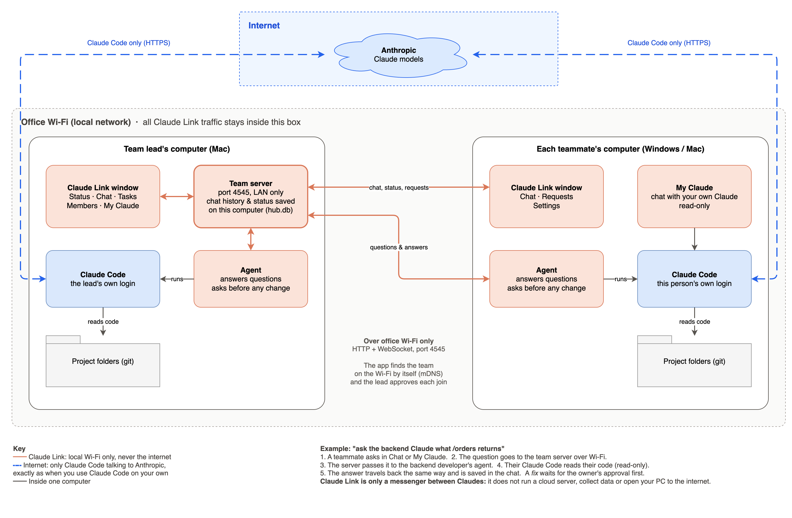

# Claude Link

Claude Link connects your team's Claude Code sessions over the office network. With it, you can:

- **See team progress.** The lead's dashboard shows each person's status, git branch, uncommitted files and recent commits.
- **Ask another person's Claude.** "Ask the backend Claude what `/orders` returns." The request runs in their repo with read-only access, and the answer comes back to you.
- **Request a fix in someone else's repo.** Their Claude makes the change on a new git branch, but only after the owner approves it.
- **Chat.** There is a `#team` channel and direct messages, and every Claude-to-Claude conversation is saved.

- **Talk to your own Claude.** The app's My Claude tab runs Claude Code on your project and can reach teammates' Claudes for you.

The lead's app shows Status, Chat, My Claude, Tasks, Members, Audit and Settings. Everyone else sees Chat, My Claude, Requests and Settings.

## How it works



The diagram source is [docs/how-it-works.drawio](docs/how-it-works.drawio); open it in [draw.io](https://www.drawio.com) to edit it.

- The lead's app runs a small **team server** on the lead's computer. It keeps the chat history and team status in one file there (`hub.db`).
- Every other app connects to that server over the office Wi-Fi. They find it automatically, and the lead approves each new computer.
- When you ask a teammate's Claude something, the question goes to the team server, then to that teammate's app. Their own Claude Code reads their code and sends the answer back the same way.
- The actual thinking is done by each person's own **Claude Code**, signed in with their own account, exactly as if they were using it in a terminal.

## Offline and safe: what Claude Link is (and isn't)

Claude Link is only a **messenger between Claudes** on your office network. It passes questions, answers and chat messages from one team member's computer to another. That is all it does.

**Claude Link itself works fully offline.**
- All of its traffic stays on the office Wi-Fi. It has no cloud server, no account system, no telemetry or analytics, and no auto-updater, and it never contacts any internet address.
- The app's screens, fonts and styles are bundled inside it, so nothing is downloaded when it runs.
- The only outside links are the "install Claude Code" and "install Git" help links on the setup screen. They open in your browser, and only if you click them.

**The only internet traffic is Claude Code.**
- Claude Code talks to Anthropic over HTTPS to run Claude, the same as when you use Claude Code on its own. That is the blue dashed line in the diagram.
- Claude Link adds no extra data to that connection, and it never sends anything to Anthropic itself.

**It is not a remote-access tool.**
- Nobody can control your computer or open a shell on it through Claude Link.
- Questions from teammates are read-only: their Claude can read your project but not change it.
- **My Claude** is read-only too.
- A *fix* request does nothing until **you**, the owner of that computer, approve it. Even then it only works on a separate git branch, never touches your current work, and never pushes anything. Not even the lead can approve a fix on your computer.
- Only the project folders you choose are shared. Your other files are not.

**Network.**
- Only the lead's computer accepts connections, on port 4545. Teammates' apps open no ports; they only connect out to the lead.
- The team server is reachable from the office network only. It is not reachable from the internet unless someone deliberately sets up the office router to forward that port.
- Joining needs the lead's approval. Every request carries a secret token, stored hashed, and the lead can remove a computer at any time.
- Every action is recorded in the **Audit** tab.

**Limits to be aware of.**
- Traffic on the Wi-Fi is plain HTTP, not encrypted. Use Claude Link on a trusted office network, not on public Wi-Fi.
- Code that Claude Code reads is sent to Anthropic as part of normal Claude Code use. Follow your company's rules for Claude Code as usual.
- The installers are not signed with a paid certificate yet. The warnings from macOS ("unidentified developer") and Windows SmartScreen ("unknown publisher") are about the missing certificate, not about anything the app does. The full source code is in this repository.


## Desktop app (recommended)

### Install
Download the installer from the repo's **Releases** page:
- **Mac:** `Claude-Link-<version>-mac-arm64.dmg` (Apple Silicon) or `-x64.dmg` (Intel). Open it and drag Claude Link to Applications.
- **Windows:** `Claude-Link-Setup-<version>.exe`. Run it and follow the installer.

The installers aren't code-signed yet, so the first launch shows a warning:
- **Mac:** right-click Claude Link in Applications, choose **Open**, then **Open** again.
- **Windows:** click **More info**, then **Run anyway**.

Everyone also needs:
- **Claude Code**, installed and logged in. Run `claude` once in a terminal to log in.
- **Git.**
- To be on the **same Wi-Fi** as the team lead.

The app checks for Claude Code and Git during setup.

### Team lead
1. Open Claude Link and choose **Create a team**.
2. Enter your name and the team name, then click **Create team**. When asked, allow incoming connections:
   - Mac: macOS asks whether to accept incoming network connections. Click **Allow**.
   - Windows: the Defender Firewall prompt appears. Tick **Private networks** and click **Allow**.
3. Choose your projects: **One project**, or **Several projects** if your repositories (e.g. frontend, backend) live in one folder. Pick that folder and every git repository inside is listed; untick any you don't want, or add projects from elsewhere.
4. Set your permissions, then click **Finish setup**.
5. Keep the app open while the team works. Closing the window keeps it running in the menu bar (Mac) or system tray (Windows).
6. When a teammate asks to join, you get a notification. Open **Members** and click **Approve**.

### Teammates
1. Open Claude Link and choose **Join a team**.
2. Pick your team from the list. If it doesn't show up, type the address shown in the lead's **Settings → Team address**.
3. Enter your name and role, then click **Send join request**.
4. Wait for the lead to approve. The app continues by itself once they do.
5. Choose your projects (**One project** or **Several projects**, as above), set your permissions, then click **Finish setup**.

Alternatively, the lead can add you under **Members → Add member** and send you an address and token. Use **Join a team → I have a token**.

### Using it
- **Chat:** `#team`, direct messages, and every Claude-to-Claude conversation. Click **Ask a teammate's Claude** to send a question or a fix request.
- **My Claude:** chat with your own Claude Code. It works on your project and can also message teammates' Claudes, for example "ask the backend Claude what `/orders` returns" or "report status: login page done".
  It is read-only: it can read your code but never changes files.
- **Approvals:** when someone's Claude wants to change your code, you get a notification and a yellow **Approve / Reject** banner.
- **Several projects:**
  - Questions can read all of them.
  - A fix gets a separate working copy of each project on the same `claude-link/task-N` branch. The branch is kept only in the projects that actually changed.
  - The diff is labelled by project, e.g. `backend/app.txt`.
- **Settings:**
  - add or remove projects;
  - turn automatic answers to questions on or off;
  - start the app when you log in;
  - optionally add the team tools to your regular Claude Code in VS Code or the terminal (off by default).

### Building the installers
```bash
npm install
npm run app          # run the app in development
npm run dist:mac     # build a .dmg on a Mac (Windows installers are built by CI)
```
Pushing a tag like `v0.2.0` runs `.github/workflows/desktop.yml`. It builds the Mac and Windows installers and attaches them to a GitHub Release.

---

## Command-line version
The app is the easiest way to run Claude Link. If you prefer terminals, the same features are also available as a CLI.

```
 Lead's laptop: claude-link hub  ◄──── WebSocket + REST ────►  claude-link agent (each teammate)
   SQLite · API · web dashboard                                  ├ MCP server → their Claude Code
                                                                 └ runs `claude -p` in their repo
```

## Requirements
- Node.js 23.6 or newer. It runs the TypeScript directly, so there is no build step except for the web UI.
- Claude Code, installed and logged in on every machine.
- Every machine on the same network as the hub.

## Setup

### 1. Team lead: start the hub
```bash
git clone <this repo> claude-link && cd claude-link
npm install && npm run build      # build the web dashboard
cd packages/cli && npm link && cd ../..   # puts `claude-link` on your PATH
claude-link hub --name "Your Name"
```
The hub prints a **Network URL** (for example `http://192.168.1.77:4545`) and your **lead token**. The token is shown only once. If you lose it, restart with `--rotate-lead-token`.
The first time it runs, macOS asks whether Node may accept incoming connections. Click **Allow**.

Open the URL, sign in with the lead token, and add teammates under **Members → Add member**. Each new member gets their own token and a join command to copy.

Connect your own Claude Code as well:
```bash
claude-link join http://127.0.0.1:4545 --token <lead-token> --repo ~/work/project
claude-link agent
```

### 2. Each teammate
```bash
# same install steps (clone, npm install, cd packages/cli && npm link), then:
claude-link join http://<lead-ip>:4545 --token <their-token> --repo ~/work/project [--hooks]
# several projects: --workspace ~/work   (adds every git repository inside)
#               or: --repo ~/work/frontend ~/work/backend
claude-link agent          # keep this running while you work
```
`join` checks the token, saves `~/.claude-link/config.json`, and registers the `claude-link` MCP server with Claude Code at user scope. The optional `--hooks` flag also adds a Claude Code hook that reports each commit to the lead's status board.

## Using it from Claude Code
Restart Claude Code after joining, then ask in plain language:

- "Ask the backend Claude what the `/api/orders` response looks like."
- "Ask Priya's Claude to fix the null check in `OrderList.tsx`." This creates a fix request that Priya must approve.
- "Report status: working on the checkout page, blocked on the payments API."
- "Show me the team status." (lead only)
- "Assign QA a task to regression-test login." (lead only)
- "Any new messages?" or "Tell the team I'm deploying staging at 5."

| Tool | What it does |
|---|---|
| `list_team` | Who is on the team and whose agent is online |
| `ask_claude` | Send a `read` question or a `fix` request to a teammate's Claude. Pass `thread_id` to follow up in the same conversation with context kept |
| `check_task`, `list_tasks` | Status, results and diffs of requests |
| `report_status` | Tell the lead what you're doing |
| `get_team_status` | Lead only: everyone's status and git activity |
| `assign_task`, `update_task` | Lead assigns work; the assignee updates its progress |
| `send_message`, `read_inbox`, `list_threads`, `read_thread` | Team chat |

## Safety model
- **Read requests** run with read-only tools only: `Read`, `Grep`, `Glob`, and `git status/log/diff/show`.
- **Fix requests** do nothing until the target machine's owner approves them, either in the agent terminal (`y/N`) or with the web banner. After approval:
  - the work runs in a separate **git worktree** on the branch `claude-link/task-<id>`, so your checkout and uncommitted work stay untouched;
  - the result is committed to that branch and **never pushed**;
  - you review it with `git diff HEAD...claude-link/task-<id>` and merge it yourself.
- Not even the lead can approve a fix on someone else's machine.
- Each request runs on the target person's own Claude Code login.
- Tokens are stored hashed. Every API call needs a token. The lead can rotate or revoke any token.
- Traffic uses plain HTTP inside the LAN. Use it only on a trusted office network.

Optional settings in `~/.claude-link/config.json`:
- `taskTimeoutMinutes` (default 15);
- `fixAllowedTools`, for example `["Bash(npm test:*)"]`, to let fixes run your tests;
- `claudeBin`, a path to the `claude` executable.

## Development
```bash
npm test            # hub API tests (vitest)
npm run typecheck
npm run dev:web     # Vite dev server on :5173, proxied to a hub on :4545
```
Code layout:
- `packages/shared` holds the protocol types and schemas.
- `packages/hub` is the Fastify server and SQLite store.
- `packages/cli` contains the `hub`, `join`, `agent`, `mcp` and `hook` commands.
- `packages/web` is the React dashboard.
- `packages/desktop` is the Electron app. It hosts the hub (lead), runs the agent and My Claude, and reuses the web UI.

Set `CLAUDE_LINK_HOME` to run several identities on one machine while testing.
